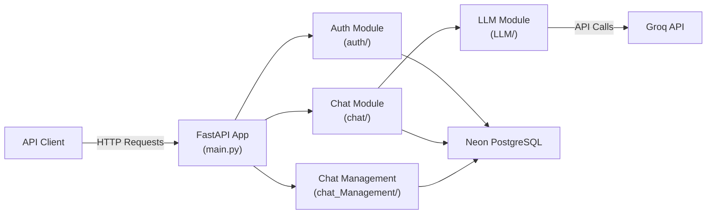
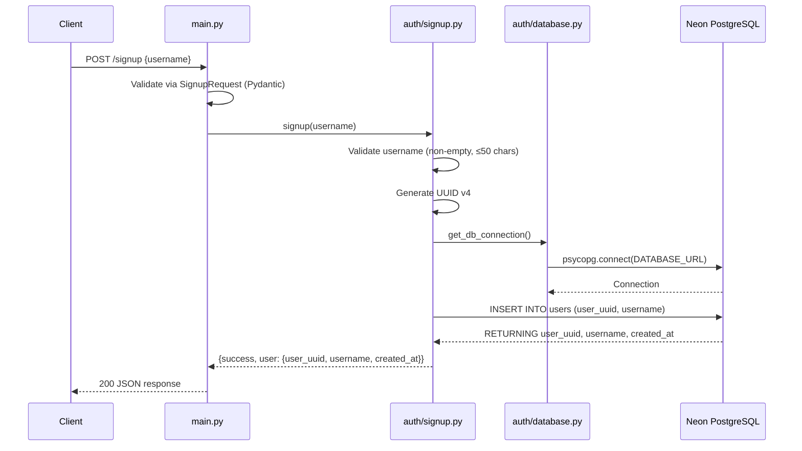
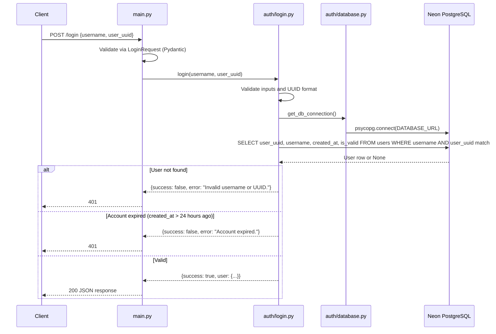
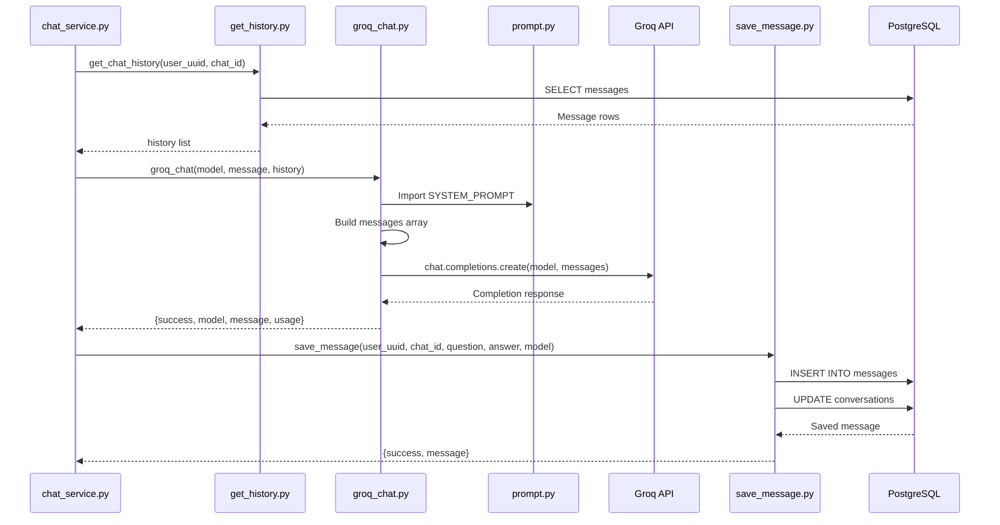
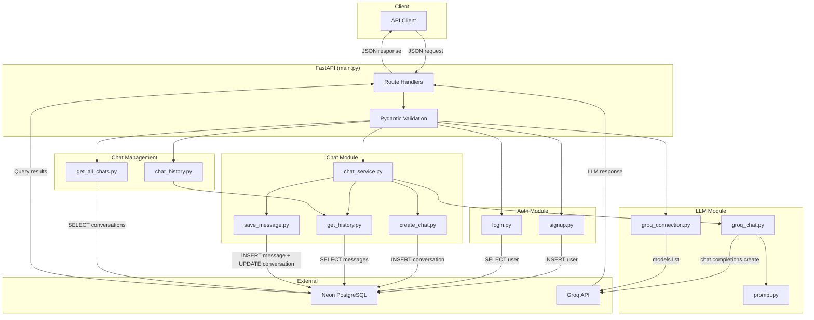

# PROJECT_FLOWS.md — Monarch AI Bot

---

## A. Application Overview

Monarch AI Bot is a backend-only REST API that enables guest users to converse with LLM models hosted on Groq. There is no frontend application in this repository — the API is consumed by external clients.

### Architecture Diagram



### Component Interaction

1. **API Client** sends HTTP requests to the **FastAPI** application.
2. **FastAPI route handlers** (`main.py`) validate request bodies via Pydantic models and delegate to the appropriate service module.
3. **Auth module** (`auth/`) handles user registration and login, reading from and writing to the **PostgreSQL database**.
4. **Chat module** (`chat/`) orchestrates conversation creation, message persistence, history retrieval, and LLM interaction.
5. **Chat Management module** (`chat_Management/`) provides validated access to conversation lists and history.
6. **LLM module** (`LLM/`) communicates with the **Groq API** for chat completions and model listing.
7. All database operations use **psycopg 3** connections obtained from `auth/database.py`.

---

## B. Authentication Flow

Monarch AI Bot uses a simple identity model: users sign up with a username, receive a UUID, and authenticate by providing both the username and UUID. Accounts expire 24 hours after creation.

### Signup Flow



**Error scenarios:**
- Empty or whitespace-only username → `ValueError`, returns `400`.
- Username exceeds 50 characters → `ValueError`, returns `400`.
- Duplicate username → `UniqueViolation` (constraint `users_username_key`), returns `400`.
- Database connection failure → `OperationalError`, returns `400`.

### Login Flow



**Key details:**
- The 24-hour check is computed in SQL: `created_at > NOW() - INTERVAL '24 hours'`.
- There are no sessions, tokens, or cookies. Each request independently verifies user identity.
- There is no logout endpoint; accounts simply expire after 24 hours.

---

## C. Main Application Flows

### 1. Application Initialization

1. `main.py` is executed by uvicorn.
2. `FastAPI()` instance is created as `app`.
3. Five Pydantic request models are defined: `SignupRequest`, `LoginRequest`, `ChatRequest`, `ChatHistoryRequest`, `AllChatsRequest`.
4. Six route handlers are registered on the app.
5. Environment variables (`DATABASE_URL`, `GROQ_API_KEY`) are loaded from `.env` by modules that call `load_dotenv()`.

### 2. Guest Signup

- **Trigger:** Client sends `POST /signup` with `{username}`.
- **Handler:** `user_signup()` in `main.py`.
- **Service:** `signup()` in `auth/signup.py`.
- **Database:** `INSERT INTO users` with generated UUID v4.
- **Response:** `{success, message, user: {user_uuid, username, created_at}}`.
- **Client action:** Client stores the returned `user_uuid` for subsequent requests.

### 3. User Login

- **Trigger:** Client sends `POST /login` with `{username, user_uuid}`.
- **Handler:** `user_login()` in `main.py`.
- **Service:** `login()` in `auth/login.py`.
- **Database:** `SELECT` from `users` matching both username and UUID; checks 24-hour validity.
- **Response:** `{success, message, user: {user_uuid, username, created_at}}` or error.

### 4. Send Message (Chat)

- **Trigger:** Client sends `POST /chat` with `{user_uuid, model, message, chat_id?}`.
- **Handler:** `user_chat()` in `main.py`.
- **Service:** `chat_service()` in `chat/chat_service.py`.
- **Detailed steps:**
  1. Validate `user_uuid`, `model`, and `message`.
  2. Query `users` table to verify user exists and is within the 24-hour window.
  3. If `chat_id` is provided, verify conversation ownership in `conversations` table.
  4. If `chat_id` is `None`, call `create_chat()` to create a new conversation.
  5. Call `get_chat_history()` to retrieve prior messages.
  6. Call `groq_chat()` with the model, message, and history.
  7. Call `save_message()` to persist the question-answer pair.
  8. Return `{success, user_uuid, chat_id, question, answer, model, usage}`.

### 5. Retrieve Chat History

- **Trigger:** Client sends `POST /chat/history` with `{user_uuid, chat_id}`.
- **Handler:** `user_chat_history()` in `main.py`.
- **Service:** `chat_history()` in `chat_Management/chat_history.py` → delegates to `get_chat_history()` in `chat/get_history.py`.
- **Database:** `SELECT question, answer, model, created_at FROM messages` ordered by `created_at ASC`.
- **Response:** `{success, chat_id, user_uuid, total_messages, history: [...]}`.

### 6. List All Conversations

- **Trigger:** Client sends `POST /chats` with `{user_uuid}`.
- **Handler:** `user_all_chats()` in `main.py`.
- **Service:** `get_all_chats()` in `chat_Management/get_all_chats.py`.
- **Database:** `SELECT chat_id, title, created_at, updated_at FROM conversations` ordered by `updated_at DESC`.
- **Response:** `{success, user_uuid, total_conversations, conversations: [...]}`.

### 7. List Available Models

- **Trigger:** Client sends `GET /models`.
- **Handler:** `available_models()` in `main.py`.
- **Service:** `get_available_models()` in `LLM/groq_connection.py`.
- **External API:** Calls `Groq.models.list()` via the Groq SDK.
- **Response:** `{success, total_models, models: [{id, owned_by, created, active, context_window, max_completion_tokens}]}`.

---

## D. Code Execution Flows

### Chat Message Flow (Complete Trace)

```
Client
  │  POST /chat {user_uuid, model, message, chat_id?}
  ▼
main.py :: user_chat(request: ChatRequest)
  │  Validates request body via Pydantic
  ▼
chat/chat_service.py :: chat_service(user_uuid, model, message, chat_id)
  │
  ├── 1. Validate inputs (ValueError if invalid)
  │
  ├── 2. auth/database.py :: get_db_connection()
  │      └── psycopg.connect(DATABASE_URL)
  │
  ├── 3. SQL: SELECT from users WHERE user_uuid → verify existence + 24-hour check
  │
  ├── 4. [If chat_id provided] SQL: SELECT from conversations → verify ownership
  │
  ├── 5. [If chat_id is None] chat/create_chat.py :: create_chat(user_uuid)
  │      └── SQL: INSERT INTO conversations → returns new chat_id
  │
  ├── 6. chat/get_history.py :: get_chat_history(user_uuid, chat_id)
  │      └── SQL: SELECT question, answer, model, created_at FROM messages ORDER BY created_at ASC
  │
  ├── 7. LLM/groq_chat.py :: groq_chat(model, message, history)
  │      ├── Build messages array: [system_prompt, ...history_pairs, user_message]
  │      ├── LLM/prompt.py :: SYSTEM_PROMPT
  │      └── Groq().chat.completions.create(model, messages)
  │          └── Groq API (external HTTP call)
  │
  ├── 8. chat/save_message.py :: save_message(user_uuid, chat_id, question, answer, model)
  │      ├── SQL: INSERT INTO messages
  │      └── SQL: UPDATE conversations SET updated_at = NOW()
  │
  └── 9. Return {success, user_uuid, chat_id, question, answer, model, usage}
         │
         ▼
main.py :: Returns JSON response (200) or raises HTTPException (400)
         │
         ▼
Client receives response
```

### Signup Flow (Complete Trace)

```
Client
  │  POST /signup {username}
  ▼
main.py :: user_signup(request: SignupRequest)
  ▼
auth/signup.py :: signup(username)
  ├── Validate username
  ├── Generate uuid.uuid4()
  ├── auth/database.py :: get_db_connection()
  ├── SQL: INSERT INTO users (user_uuid, username) RETURNING ...
  └── Return {success, message, user}
  ▼
main.py :: Returns 200 or raises HTTPException(400)
  ▼
Client receives response
```

### Login Flow (Complete Trace)

```
Client
  │  POST /login {username, user_uuid}
  ▼
main.py :: user_login(request: LoginRequest)
  ▼
auth/login.py :: login(username, user_uuid)
  ├── Validate inputs, parse UUID
  ├── auth/database.py :: get_db_connection()
  ├── SQL: SELECT ... FROM users WHERE username = %s AND user_uuid = %s
  ├── Check: user exists? → "Invalid username or UUID."
  ├── Check: is_valid (24h)? → "Account expired."
  └── Return {success, message, user}
  ▼
main.py :: Returns 200 or raises HTTPException(401)
  ▼
Client receives response
```

---

## E. API Request and Response Flows

### POST `/signup`

| Field | Detail |
|---|---|
| **Request origin** | External API client |
| **Method** | `POST` |
| **Endpoint** | `/signup` |
| **Headers** | `Content-Type: application/json` |
| **Authentication** | None required |
| **Request body** | `{"username": "string"}` |
| **Backend execution** | `main.py:user_signup` → `auth/signup.py:signup` |
| **Database interaction** | `INSERT INTO users` |
| **Response (success)** | `{"success": true, "message": "Signup successful.", "user": {"user_uuid": "...", "username": "...", "created_at": "..."}}` |
| **Response (error)** | `400` with detail message |
| **Error scenarios** | Empty username, username > 50 chars, duplicate username, database failure |

### POST `/login`

| Field | Detail |
|---|---|
| **Request origin** | External API client |
| **Method** | `POST` |
| **Endpoint** | `/login` |
| **Headers** | `Content-Type: application/json` |
| **Authentication** | None (identity verified via body parameters) |
| **Request body** | `{"username": "string", "user_uuid": "string"}` |
| **Backend execution** | `main.py:user_login` → `auth/login.py:login` |
| **Database interaction** | `SELECT FROM users` with 24-hour validity check |
| **Response (success)** | `{"success": true, "message": "Login successful.", "user": {"user_uuid": "...", "username": "...", "created_at": "..."}}` |
| **Response (error)** | `401` with detail message |
| **Error scenarios** | Invalid credentials, expired account (>24h), invalid UUID format, database failure |

### POST `/chat`

| Field | Detail |
|---|---|
| **Request origin** | External API client |
| **Method** | `POST` |
| **Endpoint** | `/chat` |
| **Headers** | `Content-Type: application/json` |
| **Authentication** | `user_uuid` in request body (verified against database) |
| **Request body** | `{"user_uuid": "string", "model": "string", "message": "string", "chat_id": "string or null"}` |
| **Backend execution** | `main.py:user_chat` → `chat/chat_service.py:chat_service` → `create_chat` / `get_chat_history` / `groq_chat` / `save_message` |
| **Database interactions** | SELECT users, SELECT/INSERT conversations, SELECT messages, INSERT messages, UPDATE conversations |
| **External API** | Groq chat completions |
| **Response (success)** | `{"success": true, "user_uuid": "...", "chat_id": "...", "question": "...", "answer": "...", "model": "...", "usage": {"prompt_tokens": N, "completion_tokens": N, "total_tokens": N}}` |
| **Response (error)** | `400` with detail message |
| **Error scenarios** | User not found, account expired, conversation not found/unauthorized, LLM errors, database failure |

### POST `/chat/history`

| Field | Detail |
|---|---|
| **Request origin** | External API client |
| **Method** | `POST` |
| **Endpoint** | `/chat/history` |
| **Headers** | `Content-Type: application/json` |
| **Authentication** | `user_uuid` in request body |
| **Request body** | `{"user_uuid": "string", "chat_id": "string"}` |
| **Backend execution** | `main.py:user_chat_history` → `chat_Management/chat_history.py:chat_history` → `chat/get_history.py:get_chat_history` |
| **Database interaction** | `SELECT FROM messages` |
| **Response (success)** | `{"success": true, "chat_id": "...", "user_uuid": "...", "total_messages": N, "history": [...]}` |
| **Response (error)** | `400` with detail message |
| **Error scenarios** | Invalid UUID format, missing parameters, database failure |

### POST `/chats`

| Field | Detail |
|---|---|
| **Request origin** | External API client |
| **Method** | `POST` |
| **Endpoint** | `/chats` |
| **Headers** | `Content-Type: application/json` |
| **Authentication** | `user_uuid` in request body |
| **Request body** | `{"user_uuid": "string"}` |
| **Backend execution** | `main.py:user_all_chats` → `chat_Management/get_all_chats.py:get_all_chats` |
| **Database interaction** | `SELECT FROM conversations` |
| **Response (success)** | `{"success": true, "user_uuid": "...", "total_conversations": N, "conversations": [...]}` |
| **Response (error)** | `400` with detail message |
| **Error scenarios** | Invalid UUID format, database failure |

### GET `/models`

| Field | Detail |
|---|---|
| **Request origin** | External API client |
| **Method** | `GET` |
| **Endpoint** | `/models` |
| **Headers** | None required |
| **Authentication** | None |
| **Request body** | None |
| **Backend execution** | `main.py:available_models` → `LLM/groq_connection.py:get_available_models` |
| **External API** | `Groq().models.list()` |
| **Response (success)** | `{"success": true, "total_models": N, "models": [...]}` |
| **Response (error)** | `500` with detail message |
| **Error scenarios** | Missing API key, invalid API key, rate limit, connection failure, API status error |

---

## F. LLM Integration Flow

### Overview

The LLM integration uses the **Groq SDK** to call Groq-hosted models for chat completions.

### Detailed Flow

1. **User message originates** from the API client via `POST /chat`.

2. **Conversation history is retrieved** by `chat_service()` calling `get_chat_history()`:
   - Queries `SELECT question, answer, model, created_at FROM messages WHERE user_uuid AND chat_id ORDER BY created_at ASC`.
   - Returns a list of `{question, answer, model, created_at}` dictionaries.

3. **System instructions are constructed** in `LLM/prompt.py`:
   - `SYSTEM_PROMPT` defines the Monarch AI personality: helpful, concise, conversational.
   - Emphasizes token efficiency and short responses by default.

4. **Messages are prepared** in `groq_chat()` (`LLM/groq_chat.py`):
   ```
   messages = [
       {"role": "system", "content": SYSTEM_PROMPT},
       // For each history item:
       {"role": "user", "content": item.question},
       {"role": "assistant", "content": item.answer},
       // Current message:
       {"role": "user", "content": message}
   ]
   ```

5. **The LLM provider is called** via:
   ```python
   client = Groq(api_key=GROQ_API_KEY)
   response = client.chat.completions.create(model=model, messages=messages)
   ```

6. **The response is processed** by extracting:
   - `response.model` — the actual model used.
   - `response.choices[0].message.content` — the generated answer.
   - `response.usage` — token usage statistics (prompt, completion, total).

7. **The response is stored** by `save_message()`:
   - `INSERT INTO messages (user_uuid, chat_id, question, answer, model)`.
   - `UPDATE conversations SET updated_at = NOW()`.

8. **The result reaches the client** as:
   ```json
   {
       "success": true,
       "user_uuid": "...",
       "chat_id": "...",
       "question": "...",
       "answer": "...",
       "model": "...",
       "usage": {"prompt_tokens": N, "completion_tokens": N, "total_tokens": N}
   }
   ```

9. **Errors and timeouts are handled** at multiple levels:
   - `ValueError` — missing API key, missing model/message, invalid history format.
   - `AuthenticationError` — invalid Groq API key.
   - `RateLimitError` — Groq rate limit exceeded.
   - `APIConnectionError` — unable to connect to Groq.
   - `APIStatusError` — other Groq API errors (status code included).
   - Generic `Exception` — unexpected errors.
   - All errors return `{success: false, error: "..."}`.

### LLM Flow Diagram



---

## G. Data Flow

### Data Flow Diagram



### Data Entities and Their Lifecycle

| Data | Origin | Processing | Storage | Return Path |
|---|---|---|---|---|
| **Username** | Client (`POST /signup`) | Validated (non-empty, ≤50 chars, trimmed) | `users.username` | Returned in signup/login responses |
| **User UUID** | Generated server-side (`uuid.uuid4()`) | Used as primary identity key | `users.user_uuid` | Returned to client on signup; required in all subsequent requests |
| **24-hour validity** | Computed in SQL (`created_at > NOW() - INTERVAL '24 hours'`) | Checked on login and chat | Not stored (derived) | Error returned if expired |
| **Chat ID** | Generated by database on `INSERT INTO conversations` | Used to scope messages to a conversation | `conversations.chat_id` | Returned on chat creation and in responses |
| **Conversation title** | Database default (currently `NULL`) | Not processed | `conversations.title` | Returned in conversation lists |
| **User message** | Client (`POST /chat`) | Passed to LLM as latest user message; saved to DB | `messages.question` | Echoed in chat response |
| **LLM answer** | Groq API response | Extracted from `response.choices[0].message.content` | `messages.answer` | Returned to client |
| **Model ID** | Client selects; actual model returned by Groq | Passed to Groq; actual model stored | `messages.model` | Returned in chat response |
| **Token usage** | Groq API response `usage` field | Extracted (prompt, completion, total tokens) | Not stored | Returned to client in chat response |
| **Conversation history** | `messages` table | Queried by `get_chat_history`, formatted into user/assistant message pairs | Already in DB | Sent to Groq as context; returned to client via `/chat/history` |

---

## H. Error Handling Flow

### Error Propagation Pattern

All service functions follow a consistent pattern:

1. **Validation errors** (`ValueError`) are caught first — invalid inputs, missing fields, bad UUID format.
2. **Database-specific errors** (`psycopg.errors.*` or `psycopg.Error`) are caught — connection failures, constraint violations, data errors.
3. **External API errors** (Groq SDK exceptions) are caught — authentication, rate limit, connection, status errors.
4. **Generic exceptions** (`Exception`) are caught as a final fallback.

All errors return a `{success: false, error: "..."}` dictionary from the service function.

### Error Flow by Layer

```
Service Function
  │  Returns {success: false, error: "..."}
  ▼
main.py Route Handler
  │  Checks response["success"]
  │  If false: raises HTTPException(status_code, detail=response["error"])
  ▼
FastAPI Framework
  │  Converts HTTPException to JSON error response
  ▼
Client receives {"detail": "error message"} with appropriate HTTP status code
```

### HTTP Status Codes Used

| Status Code | Used By | Meaning |
|---|---|---|
| `200` | All endpoints (success) | Request processed successfully |
| `400` | `/signup`, `/chat`, `/chat/history`, `/chats` | Bad request — validation failure, user not found, expired account |
| `401` | `/login` | Unauthorized — invalid credentials or expired account |
| `500` | `/models` | Internal server error — Groq API failure |

### Specific Error Scenarios

| Scenario | Module | Error Message | HTTP Code |
|---|---|---|---|
| Empty username | `auth/signup.py` | "Username is required." | 400 |
| Username too long | `auth/signup.py` | "Username cannot exceed 50 characters." | 400 |
| Duplicate username | `auth/signup.py` | "Username already exists. Choose another username." | 400 |
| Invalid credentials | `auth/login.py` | "Invalid username or UUID." | 401 |
| Account expired | `auth/login.py`, `chat/chat_service.py` | "Account expired. The 24-hour signup period has ended." | 401 / 400 |
| User not found (chat) | `chat/chat_service.py` | "User not found." | 400 |
| Conversation not found | `chat/chat_service.py` | "Conversation not found or does not belong to this user." | 400 |
| Invalid Groq API key | `LLM/groq_chat.py`, `LLM/groq_connection.py` | "Invalid Groq API key." | 400 / 500 |
| Groq rate limit | `LLM/groq_chat.py`, `LLM/groq_connection.py` | "Groq API rate limit exceeded." | 400 / 500 |
| Groq connection failure | `LLM/groq_chat.py`, `LLM/groq_connection.py` | "Unable to connect to Groq API." | 400 / 500 |
| Database connection failure | `auth/database.py` | "Failed to connect to Neon PostgreSQL: ..." | Propagated |
| Missing DATABASE_URL | `auth/database.py` | "DATABASE_URL is not configured" | Propagated |
| Missing GROQ_API_KEY | `LLM/groq_chat.py`, `LLM/groq_connection.py` | "GROQ_API_KEY is not configured" | 400 / 500 |

---

## I. Background and Scheduled Processes

**No background jobs, scheduled tasks, cleanup operations, or asynchronous processing are currently implemented.**

All operations are synchronous and executed within the scope of individual HTTP request-response cycles. There are no:
- Periodic account cleanup jobs (expired 24-hour accounts persist in the database).
- Message queue consumers.
- Scheduled model refresh tasks.
- WebSocket connections or streaming responses.

---

## J. Flow Accuracy Rules — Verification Notes

- All documented flows correspond to actual code in the repository.
- Function names, API paths, file locations, and module structures match the codebase exactly.
- No unimplemented or planned features are documented as active.
- All operations documented are synchronous (no `async def` is used in any function).
- Database operations are identified with their specific SQL statements.
- The Groq API is the only external service boundary.
- Mermaid diagrams match the written flow descriptions.

