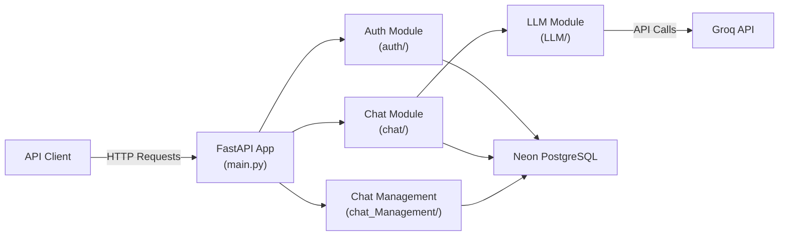
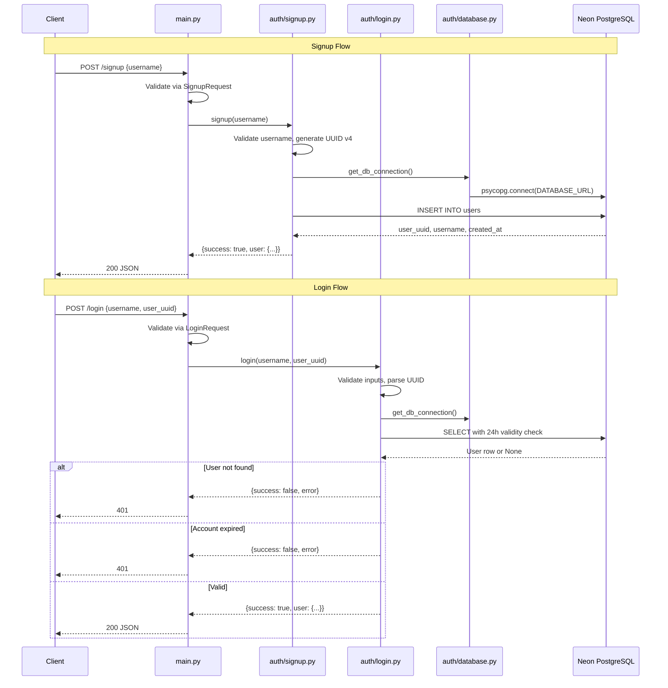
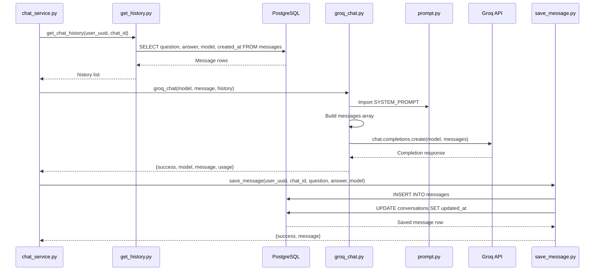
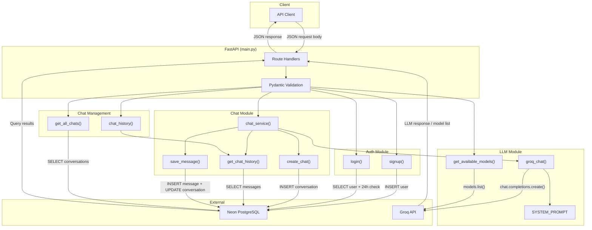

# PROJECT_FLOWS.md — Monarch AI Bot

---

## A. Application Overview

Monarch AI Bot is a backend-only REST API that enables guest users to converse with LLM models hosted on Groq. There is no frontend application in this repository — the API is consumed by external clients.

### High-Level Architecture Diagram



### Component Interaction

1. **API Client** sends HTTP requests to the **FastAPI** application.
2. **FastAPI route handlers** (`main.py`) validate request bodies via Pydantic models and delegate to the appropriate service module.
3. **Auth module** (`auth/`) handles user registration and login, reading from and writing to the **PostgreSQL database**.
4. **Chat module** (`chat/`) orchestrates conversation creation, message persistence, history retrieval, and LLM interaction.
5. **Chat Management module** (`chat_Management/`) provides validated access to conversation lists and history.
6. **LLM module** (`LLM/`) communicates with the **Groq API** for chat completions and model listing.
7. All database operations use **psycopg 3** connections obtained from `auth/database.py`.

There is no frontend. All operations are synchronous (`def`, not `async def`).

---

## B. Authentication Flow

Monarch AI Bot uses a simple identity model: users sign up with a username, receive a UUID, and authenticate by providing both the username and UUID. Accounts expire 24 hours after creation.

### Signup Flow

1. **User action:** Client sends `POST /signup` with `{"username": "..."}`.
2. **Frontend processing:** Not applicable — no frontend exists.
3. **API request:** FastAPI validates the body using `SignupRequest` (Pydantic).
4. **Backend validation:** `signup()` in `auth/signup.py` validates the username (non-empty, ≤ 50 characters, trimmed).
5. **Database operations:** Generates `uuid.uuid4()`, executes `INSERT INTO users (user_uuid, username) VALUES (%s, %s) RETURNING user_uuid, username, created_at`.
6. **Session creation:** No session is created. The returned `user_uuid` serves as the identity credential.
7. **Response:** `{"success": true, "message": "Signup successful.", "user": {"user_uuid": "...", "username": "...", "created_at": "..."}}`.

### Login Flow

1. **User action:** Client sends `POST /login` with `{"username": "...", "user_uuid": "..."}`.
2. **API request:** FastAPI validates the body using `LoginRequest` (Pydantic).
3. **Backend validation:** `login()` in `auth/login.py` validates inputs and parses the UUID.
4. **Database operations:** Executes `SELECT user_uuid, username, created_at, (created_at > NOW() - INTERVAL '24 hours') AS is_valid FROM users WHERE username = %s AND user_uuid = %s`.
5. **Checks:** If no user found → `"Invalid username or UUID."`. If `is_valid` is false → `"Account expired. The 24-hour signup period has ended."`.
6. **Response:** `{"success": true, "message": "Login successful.", "user": {"user_uuid": "...", "username": "...", "created_at": "..."}}`.

### Subsequent Authentication

There are no sessions, tokens, or cookies. Each API request independently verifies user identity by matching `user_uuid` against the database and checking the 24-hour window.

### Session Expiry

Accounts become inaccessible after 24 hours. The check is computed in SQL: `created_at > NOW() - INTERVAL '24 hours'`. Expired accounts are not deleted — they persist in the database but all login and chat requests are rejected.

### Logout

No logout endpoint is implemented. Accounts simply expire after 24 hours.

### Sequence Diagram



---

## C. Main Application Flows

### 1. Application Initialization

- **Trigger:** `uvicorn main:app` is executed.
- **Backend:** `main.py` is loaded. `FastAPI()` instance is created as `app`. Five Pydantic request models are defined (`SignupRequest`, `LoginRequest`, `ChatRequest`, `ChatHistoryRequest`, `AllChatsRequest`). Six route handlers are registered. Module-level `load_dotenv()` calls in `auth/database.py`, `LLM/groq_connection.py`, and `LLM/groq_chat.py` load environment variables from `.env`.
- **No frontend component** is involved.

### 2. Guest Signup

- **Trigger:** Client sends `POST /signup` with `{"username": "..."}`.
- **API endpoint:** `POST /signup`.
- **Backend functions:** `main.py:user_signup()` → `auth/signup.py:signup()`.
- **Services:** `auth/database.py:get_db_connection()`.
- **Database operations:** `INSERT INTO users (user_uuid, username)`.
- **Response:** `{"success": true, "message": "Signup successful.", "user": {"user_uuid": "...", "username": "...", "created_at": "..."}}`.

### 3. User Login

- **Trigger:** Client sends `POST /login` with `{"username": "...", "user_uuid": "..."}`.
- **API endpoint:** `POST /login`.
- **Backend functions:** `main.py:user_login()` → `auth/login.py:login()`.
- **Services:** `auth/database.py:get_db_connection()`.
- **Database operations:** `SELECT FROM users WHERE username AND user_uuid match` with 24-hour validity check.
- **Response:** `{"success": true, "message": "Login successful.", "user": {...}}` or 401 error.

### 4. New Conversation Creation

- **Trigger:** Client sends `POST /chat` without a `chat_id` (or with `chat_id: null`).
- **API endpoint:** `POST /chat`.
- **Backend functions:** `main.py:user_chat()` → `chat/chat_service.py:chat_service()` → `chat/create_chat.py:create_chat()`.
- **Database operations:** `INSERT INTO conversations (user_uuid)`.
- **Response:** A new `chat_id` is generated and included in the chat response.

### 5. Message Submission and LLM Response Generation

- **Trigger:** Client sends `POST /chat` with `{"user_uuid", "model", "message", "chat_id?"}`.
- **API endpoint:** `POST /chat`.
- **Backend functions:** `main.py:user_chat()` → `chat/chat_service.py:chat_service()`.
- **Services involved:**
  1. `auth/database.py:get_db_connection()` — database connection.
  2. `chat/create_chat.py:create_chat()` — if no `chat_id` provided.
  3. `chat/get_history.py:get_chat_history()` — retrieve prior messages.
  4. `LLM/groq_chat.py:groq_chat()` — generate LLM response.
  5. `chat/save_message.py:save_message()` — persist the Q&A pair.
- **Database operations:** `SELECT FROM users` (eligibility), `SELECT FROM conversations` (ownership), `INSERT INTO conversations` (if new), `SELECT FROM messages` (history), `INSERT INTO messages` (save), `UPDATE conversations SET updated_at` (timestamp).
- **External API:** `Groq().chat.completions.create()`.
- **Response:** `{"success": true, "user_uuid": "...", "chat_id": "...", "question": "...", "answer": "...", "model": "...", "usage": {...}}`.

### 6. Conversation History Retrieval

- **Trigger:** Client sends `POST /chat/history` with `{"user_uuid", "chat_id"}`.
- **API endpoint:** `POST /chat/history`.
- **Backend functions:** `main.py:user_chat_history()` → `chat_Management/chat_history.py:chat_history()` → `chat/get_history.py:get_chat_history()`.
- **Database operations:** `SELECT question, answer, model, created_at FROM messages WHERE user_uuid AND chat_id ORDER BY created_at ASC`.
- **Response:** `{"success": true, "chat_id": "...", "user_uuid": "...", "total_messages": N, "history": [...]}`.

### 7. List All Conversations

- **Trigger:** Client sends `POST /chats` with `{"user_uuid"}`.
- **API endpoint:** `POST /chats`.
- **Backend functions:** `main.py:user_all_chats()` → `chat_Management/get_all_chats.py:get_all_chats()`.
- **Database operations:** `SELECT chat_id, title, created_at, updated_at FROM conversations WHERE user_uuid ORDER BY updated_at DESC`.
- **Response:** `{"success": true, "user_uuid": "...", "total_conversations": N, "conversations": [...]}`.

### 8. List Available Models

- **Trigger:** Client sends `GET /models`.
- **API endpoint:** `GET /models`.
- **Backend functions:** `main.py:available_models()` → `LLM/groq_connection.py:get_available_models()`.
- **External API:** `Groq().models.list()`.
- **Response:** `{"success": true, "total_models": N, "models": [{id, owned_by, created, active, context_window, max_completion_tokens}]}`.

### Not Implemented

The following flows are **not implemented** in the current codebase:
- Session restoration (no sessions exist).
- Conversation switching (no endpoint; client manages locally).
- Conversation deletion (no delete endpoint).
- Logout (no endpoint; accounts expire after 24 hours).

---

## D. Code Execution Flows

### Chat Message Flow (Complete Trace)

```
Client
  │  POST /chat {user_uuid, model, message, chat_id?}
  ▼
main.py :: user_chat(request: ChatRequest)
  │  Pydantic validates request body
  ▼
chat/chat_service.py :: chat_service(user_uuid, model, message, chat_id)
  │
  ├── 1. Validate inputs (ValueError if empty/invalid)
  │
  ├── 2. auth/database.py :: get_db_connection()
  │      └── psycopg.connect(DATABASE_URL)
  │
  ├── 3. SQL: SELECT (created_at > NOW() - INTERVAL '24 hours') FROM users WHERE user_uuid = %s
  │      └── Check: user exists? → "User not found."
  │      └── Check: is_valid? → "Account expired."
  │
  ├── 4. [If chat_id provided] SQL: SELECT chat_id FROM conversations WHERE chat_id = %s AND user_uuid = %s
  │      └── Check: exists? → "Conversation not found or does not belong to this user."
  │
  ├── 5. [If chat_id is None] chat/create_chat.py :: create_chat(user_uuid)
  │      └── SQL: INSERT INTO conversations (user_uuid) RETURNING chat_id, ...
  │
  ├── 6. chat/get_history.py :: get_chat_history(user_uuid, chat_id)
  │      └── SQL: SELECT question, answer, model, created_at FROM messages ORDER BY created_at ASC
  │
  ├── 7. LLM/groq_chat.py :: groq_chat(model, message, history)
  │      ├── LLM/prompt.py :: SYSTEM_PROMPT
  │      ├── Build messages: [system, ...history_pairs, user_message]
  │      └── Groq().chat.completions.create(model, messages) → Groq API
  │
  ├── 8. chat/save_message.py :: save_message(user_uuid, chat_id, question, answer, model)
  │      ├── SQL: INSERT INTO messages (user_uuid, chat_id, question, answer, model)
  │      └── SQL: UPDATE conversations SET updated_at = NOW() WHERE chat_id AND user_uuid
  │
  └── 9. Return {success, user_uuid, chat_id, question, answer, model, usage}
         ▼
main.py :: Returns 200 JSON or raises HTTPException(400)
         ▼
Client receives response
```

### Signup Flow (Complete Trace)

```
Client
  │  POST /signup {username}
  ▼
main.py :: user_signup(request: SignupRequest)
  ▼
auth/signup.py :: signup(username)
  ├── Validate username (non-empty, ≤ 50 chars, trimmed)
  ├── Generate uuid.uuid4()
  ├── auth/database.py :: get_db_connection()
  ├── SQL: INSERT INTO users (user_uuid, username) RETURNING user_uuid, username, created_at
  └── Return {success, message, user}
  ▼
main.py :: Returns 200 or raises HTTPException(400)
  ▼
Client receives response
```

### Login Flow (Complete Trace)

```
Client
  │  POST /login {username, user_uuid}
  ▼
main.py :: user_login(request: LoginRequest)
  ▼
auth/login.py :: login(username, user_uuid)
  ├── Validate inputs, parse UUID format
  ├── auth/database.py :: get_db_connection()
  ├── SQL: SELECT user_uuid, username, created_at, (created_at > NOW() - INTERVAL '24 hours') AS is_valid
  │        FROM users WHERE username = %s AND user_uuid = %s
  ├── Check: user not found → "Invalid username or UUID."
  ├── Check: not is_valid → "Account expired."
  └── Return {success, message, user}
  ▼
main.py :: Returns 200 or raises HTTPException(401)
  ▼
Client receives response
```

---

## E. API Request and Response Flows

### POST `/signup`

- **Request origin:** External API client.
- **HTTP method and endpoint:** `POST /signup`.
- **Headers:** `Content-Type: application/json`.
- **Authentication:** None required.
- **Request body:** `{"username": "string"}`.
- **Backend execution:** `main.py:user_signup()` → `auth/signup.py:signup()`.
- **Database interactions:** `INSERT INTO users (user_uuid, username)`.
- **External API interactions:** None.
- **Response (success):** `{"success": true, "message": "Signup successful.", "user": {"user_uuid": "...", "username": "...", "created_at": "..."}}`.
- **Error scenarios:**
  - Empty or whitespace-only username → 400.
  - Username exceeds 50 characters → 400.
  - Duplicate username (`UniqueViolation`, constraint `users_username_key`) → 400.
  - Database connection failure → 400.

### POST `/login`

- **Request origin:** External API client.
- **HTTP method and endpoint:** `POST /login`.
- **Headers:** `Content-Type: application/json`.
- **Authentication:** None (identity verified via body parameters).
- **Request body:** `{"username": "string", "user_uuid": "string"}`.
- **Backend execution:** `main.py:user_login()` → `auth/login.py:login()`.
- **Database interactions:** `SELECT FROM users` with 24-hour validity check.
- **External API interactions:** None.
- **Response (success):** `{"success": true, "message": "Login successful.", "user": {"user_uuid": "...", "username": "...", "created_at": "..."}}`.
- **Error scenarios:**
  - Invalid credentials → 401, `"Invalid username or UUID."`.
  - Expired account → 401, `"Account expired. The 24-hour signup period has ended."`.
  - Invalid UUID format → 401.
  - Database failure → 401.

### POST `/chat`

- **Request origin:** External API client.
- **HTTP method and endpoint:** `POST /chat`.
- **Headers:** `Content-Type: application/json`.
- **Authentication:** `user_uuid` in request body (verified against database).
- **Request body:** `{"user_uuid": "string", "model": "string", "message": "string", "chat_id": "string or null"}`.
- **Backend execution:** `main.py:user_chat()` → `chat/chat_service.py:chat_service()` → `create_chat()` / `get_chat_history()` / `groq_chat()` / `save_message()`.
- **Database interactions:** SELECT users, SELECT/INSERT conversations, SELECT messages, INSERT messages, UPDATE conversations.
- **External API interactions:** Groq chat completions (`client.chat.completions.create()`).
- **Response (success):** `{"success": true, "user_uuid": "...", "chat_id": "...", "question": "...", "answer": "...", "model": "...", "usage": {"prompt_tokens": N, "completion_tokens": N, "total_tokens": N}}`.
- **Error scenarios:**
  - User not found → 400, `"User not found."`.
  - Account expired → 400, `"Account expired."`.
  - Conversation not found / not owned → 400.
  - Invalid UUID format → 400.
  - LLM errors (auth, rate limit, connection, API status) → 400.
  - Database failure → 400.

### POST `/chat/history`

- **Request origin:** External API client.
- **HTTP method and endpoint:** `POST /chat/history`.
- **Headers:** `Content-Type: application/json`.
- **Authentication:** `user_uuid` in request body.
- **Request body:** `{"user_uuid": "string", "chat_id": "string"}`.
- **Backend execution:** `main.py:user_chat_history()` → `chat_Management/chat_history.py:chat_history()` → `chat/get_history.py:get_chat_history()`.
- **Database interactions:** `SELECT FROM messages`.
- **External API interactions:** None.
- **Response (success):** `{"success": true, "chat_id": "...", "user_uuid": "...", "total_messages": N, "history": [{"question": "...", "answer": "...", "model": "...", "created_at": "..."}]}`.
- **Error scenarios:** Invalid UUID format → 400. Missing parameters → 400. Database failure → 400.

### POST `/chats`

- **Request origin:** External API client.
- **HTTP method and endpoint:** `POST /chats`.
- **Headers:** `Content-Type: application/json`.
- **Authentication:** `user_uuid` in request body.
- **Request body:** `{"user_uuid": "string"}`.
- **Backend execution:** `main.py:user_all_chats()` → `chat_Management/get_all_chats.py:get_all_chats()`.
- **Database interactions:** `SELECT FROM conversations`.
- **External API interactions:** None.
- **Response (success):** `{"success": true, "user_uuid": "...", "total_conversations": N, "conversations": [{"chat_id": "...", "title": "...", "created_at": "...", "updated_at": "..."}]}`.
- **Error scenarios:** Invalid UUID format → 400. Database failure → 400.

### GET `/models`

- **Request origin:** External API client.
- **HTTP method and endpoint:** `GET /models`.
- **Headers:** None required.
- **Authentication:** None.
- **Request body:** None.
- **Backend execution:** `main.py:available_models()` → `LLM/groq_connection.py:get_available_models()`.
- **Database interactions:** None.
- **External API interactions:** `Groq().models.list()`.
- **Response (success):** `{"success": true, "total_models": N, "models": [{"id": "...", "owned_by": "...", "created": "...", "active": true, "context_window": N, "max_completion_tokens": N}]}`.
- **Error scenarios:** Missing API key → 500. Invalid API key → 500. Rate limit → 500. Connection failure → 500. API status error → 500.

---

## F. LLM Integration Flow

### Detailed Flow

1. **User message originates** from the API client via `POST /chat` → `main.py:user_chat()`.

2. **Conversation history is retrieved** by `chat_service()` calling `get_chat_history()` in `chat/get_history.py`:
   - SQL: `SELECT question, answer, model, created_at FROM messages WHERE user_uuid = %s AND chat_id = %s ORDER BY created_at ASC`.
   - Returns a list of `{"question", "answer", "model", "created_at"}` dictionaries.

3. **System instructions are constructed** in `LLM/prompt.py`:
   - `SYSTEM_PROMPT` is a constant string that defines the Monarch AI personality: helpful, concise, conversational.
   - Emphasizes token efficiency, short responses by default, and natural conversation.

4. **Messages are prepared** in `groq_chat()` (`LLM/groq_chat.py`):
   ```
   messages = [
       {"role": "system", "content": SYSTEM_PROMPT},
       // For each history item:
       {"role": "user", "content": item["question"]},
       {"role": "assistant", "content": item["answer"]},
       // Current user message:
       {"role": "user", "content": message}
   ]
   ```

5. **The LLM provider is called** via:
   ```python
   client = Groq(api_key=os.getenv("GROQ_API_KEY"))
   response = client.chat.completions.create(model=model, messages=messages)
   ```

6. **The response is processed** by extracting:
   - `response.model` — the actual model that served the request.
   - `response.choices[0].message.content` — the generated answer text.
   - `response.usage.prompt_tokens`, `response.usage.completion_tokens`, `response.usage.total_tokens` — token usage statistics.

7. **The response is stored** by `save_message()` in `chat/save_message.py`:
   - SQL: `INSERT INTO messages (user_uuid, chat_id, question, answer, model) VALUES (...)`.
   - SQL: `UPDATE conversations SET updated_at = NOW() WHERE chat_id = %s AND user_uuid = %s`.

8. **The result reaches the client** as a JSON response from `chat_service()` through `main.py:user_chat()`:
   ```json
   {
       "success": true,
       "user_uuid": "...",
       "chat_id": "...",
       "question": "...",
       "answer": "...",
       "model": "...",
       "usage": {"prompt_tokens": 0, "completion_tokens": 0, "total_tokens": 0}
   }
   ```

9. **Errors and timeouts are handled** in `groq_chat()` with specific exception handlers:
   - `ValueError` — missing API key, missing model/message, invalid history format.
   - `AuthenticationError` — `"Invalid Groq API key."`.
   - `RateLimitError` — `"Groq API rate limit exceeded."`.
   - `APIConnectionError` — `"Unable to connect to Groq API."`.
   - `APIStatusError` — `"Groq API error: {status_code}"`.
   - Generic `Exception` — `"An unexpected error occurred during chat completion."`.
   - All return `{"success": false, "error": "..."}`.

### LLM Sequence Diagram



---

## G. Data Flow

### Data Flow Diagram



### Data Entities and Their Lifecycle

| Data | Origin | Processing | Storage | Return Path |
|---|---|---|---|---|
| **Username** | Client (`POST /signup`) | Validated (non-empty, ≤ 50 chars, trimmed) | `users.username` | Returned in signup/login responses |
| **User UUID** | Server-generated (`uuid.uuid4()`) | Used as primary identity credential | `users.user_uuid` | Returned on signup; required in all subsequent requests |
| **24-hour validity** | Computed in SQL (`created_at > NOW() - INTERVAL '24 hours'`) | Checked on login and chat | Not stored (derived at query time) | Error returned if expired |
| **Chat ID** | Database-generated on `INSERT INTO conversations` | Used to scope messages to a conversation | `conversations.chat_id` | Returned on conversation creation and in chat responses |
| **Conversation title** | Database default | Not processed (no generation logic) | `conversations.title` (currently `NULL`) | Returned in conversation listings |
| **User message** | Client (`POST /chat`, `message` field) | Passed to LLM and saved to DB | `messages.question` | Echoed in chat response |
| **LLM answer** | Groq API response (`response.choices[0].message.content`) | Extracted and returned | `messages.answer` | Returned to client in chat response |
| **Model ID** | Client selects; actual model returned by Groq | Passed to Groq SDK; actual model ID stored | `messages.model` | Returned in chat response |
| **Token usage** | Groq API response (`response.usage`) | Extracted (prompt, completion, total tokens) | Not persisted | Returned to client in chat response |
| **System prompt** | `LLM/prompt.py :: SYSTEM_PROMPT` constant | Prepended to every LLM request | Not stored in DB | Not returned to client |
| **Conversation history** | `messages` table | Queried, formatted into user/assistant pairs for LLM context | Already persisted | Sent to Groq as context; returned to client via `/chat/history` |

---

## H. Error Handling Flow

### Error Propagation Pattern

All service functions follow a consistent pattern:

1. **Input validation errors** (`ValueError`) are caught first — empty fields, invalid UUID format, invalid data types.
2. **Database-specific errors** (`psycopg.errors.*` or `psycopg.Error`) are caught next — connection failures, constraint violations, data errors.
3. **External API errors** (Groq SDK exceptions: `AuthenticationError`, `RateLimitError`, `APIConnectionError`, `APIStatusError`) are caught in LLM functions.
4. **Generic exceptions** (`Exception`) are caught as a final fallback.

All errors return a `{"success": false, "error": "..."}` dictionary from the service function.

### Error Flow Through the Stack

```
Service Function (auth/, chat/, chat_Management/, LLM/)
  │  Catches exception
  │  Returns {"success": false, "error": "..."}
  ▼
main.py Route Handler
  │  Checks response["success"]
  │  If false: raises HTTPException(status_code, detail=response["error"])
  ▼
FastAPI Framework
  │  Converts HTTPException to JSON error response
  ▼
Client receives {"detail": "error message"} with appropriate HTTP status code
```

### HTTP Status Codes Used

| Status Code | Used By | Meaning |
|---|---|---|
| `200` | All endpoints (on success) | Request processed successfully |
| `400` | `/signup`, `/chat`, `/chat/history`, `/chats` | Bad request — validation failure, user not found, expired account, LLM error |
| `401` | `/login` | Unauthorized — invalid credentials or expired account |
| `500` | `/models` | Internal server error — Groq API failure |

### Specific Error Scenarios

| Scenario | Module | Error Message | HTTP Code |
|---|---|---|---|
| Empty username | `auth/signup.py` | `"Username is required."` | 400 |
| Username too long | `auth/signup.py` | `"Username cannot exceed 50 characters."` | 400 |
| Duplicate username | `auth/signup.py` | `"Username already exists. Choose another username."` | 400 |
| UUID conflict | `auth/signup.py` | `"A unique identifier conflict occurred."` | 400 |
| DB connection failed (signup) | `auth/signup.py` | `"Database connection failed. Please try again later."` | 400 |
| Invalid data (signup) | `auth/signup.py` | `"Invalid data provided for user registration."` | 400 |
| Invalid credentials | `auth/login.py` | `"Invalid username or UUID."` | 401 |
| Account expired (login) | `auth/login.py` | `"Account expired. The 24-hour signup period has ended."` | 401 |
| Invalid UUID format (login) | `auth/login.py` | `"Invalid UUID format."` | 401 |
| DB connection failed (login) | `auth/login.py` | `"Database connection failed. Please try again later."` | 401 |
| User not found (chat) | `chat/chat_service.py` | `"User not found."` | 400 |
| Account expired (chat) | `chat/chat_service.py` | `"Account expired. The 24-hour signup period has ended."` | 400 |
| Conversation not found | `chat/chat_service.py` | `"Conversation not found or does not belong to this user."` | 400 |
| Invalid Groq API key | `LLM/groq_chat.py` | `"Invalid Groq API key."` | 400 |
| Groq rate limit | `LLM/groq_chat.py` | `"Groq API rate limit exceeded."` | 400 |
| Groq connection failure | `LLM/groq_chat.py` | `"Unable to connect to Groq API."` | 400 |
| Groq API status error | `LLM/groq_chat.py` | `"Groq API error: {status_code}"` | 400 |
| Missing GROQ_API_KEY | `LLM/groq_chat.py` | `"GROQ_API_KEY is not configured"` | 400 |
| Missing DATABASE_URL | `auth/database.py` | `"DATABASE_URL is not configured"` | Propagated as ValueError |
| Invalid Groq API key (models) | `LLM/groq_connection.py` | `"Invalid Groq API key."` | 500 |
| Groq rate limit (models) | `LLM/groq_connection.py` | `"Groq API rate limit exceeded."` | 500 |
| Missing GROQ_API_KEY (models) | `LLM/groq_connection.py` | `"GROQ_API_KEY is not configured"` | 500 |

### Frontend Error Handling

No frontend exists. There is no frontend validation or error presentation. All errors are returned as JSON HTTP responses to the API client.

---

## I. Background and Scheduled Processes

**No background jobs, scheduled tasks, cleanup operations, or asynchronous processing are currently implemented.**

All operations are synchronous and executed within the scope of individual HTTP request-response cycles. There are no:
- Periodic account cleanup jobs (expired 24-hour accounts persist in the database).
- Message queue consumers.
- Scheduled model refresh tasks.
- WebSocket connections or streaming responses.
- Async task queues.

---

## J. Flow Accuracy Rules — Verification Notes

- Every flow documented above corresponds to actual code in the repository.
- All function names, API paths, file locations, and module structures match the codebase exactly.
- No unimplemented or planned features are documented as active.
- All operations are synchronous (`def`, not `async def`).
- Database operations are identified with their specific SQL statements.
- The Groq API is the only external service boundary.
- Mermaid diagrams match the written flow descriptions.
- Frontend execution is never referenced because no frontend exists.
- No incomplete or partially implemented flows were identified — all documented endpoints are fully functional.
