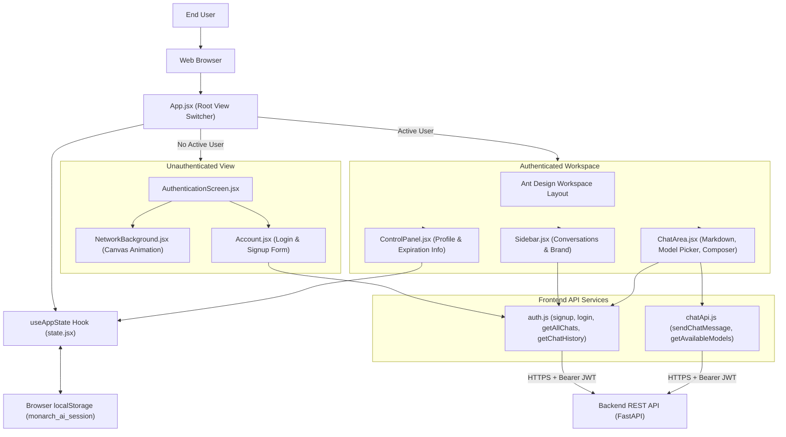
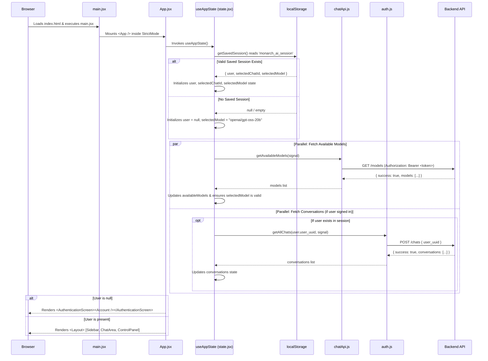
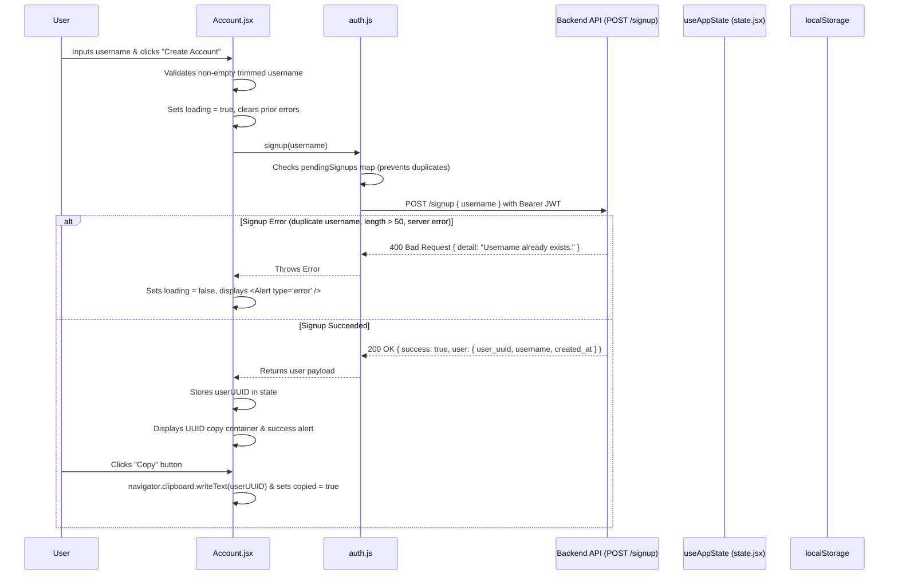
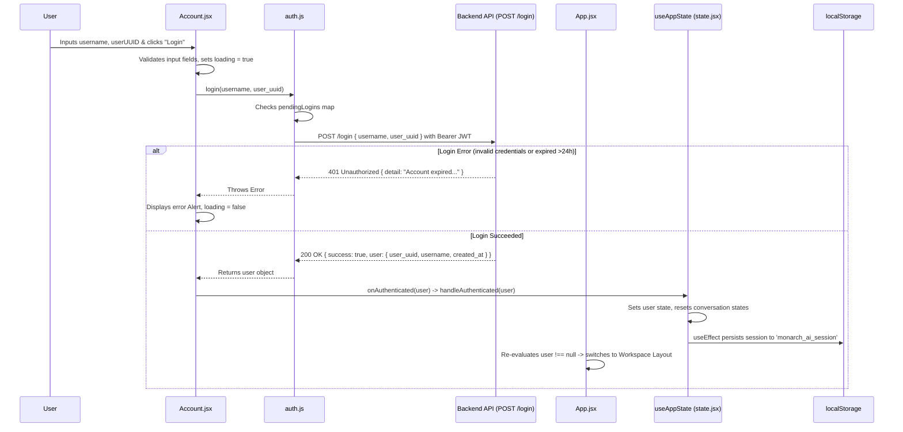
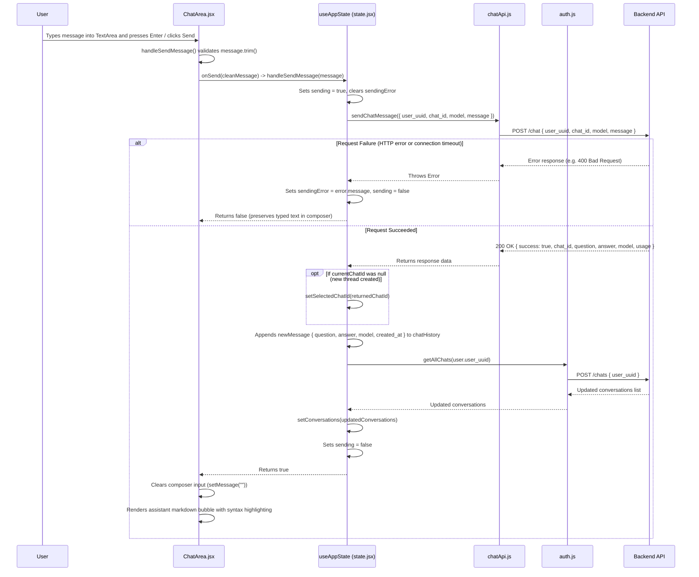
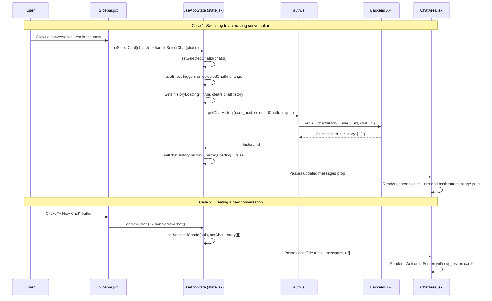
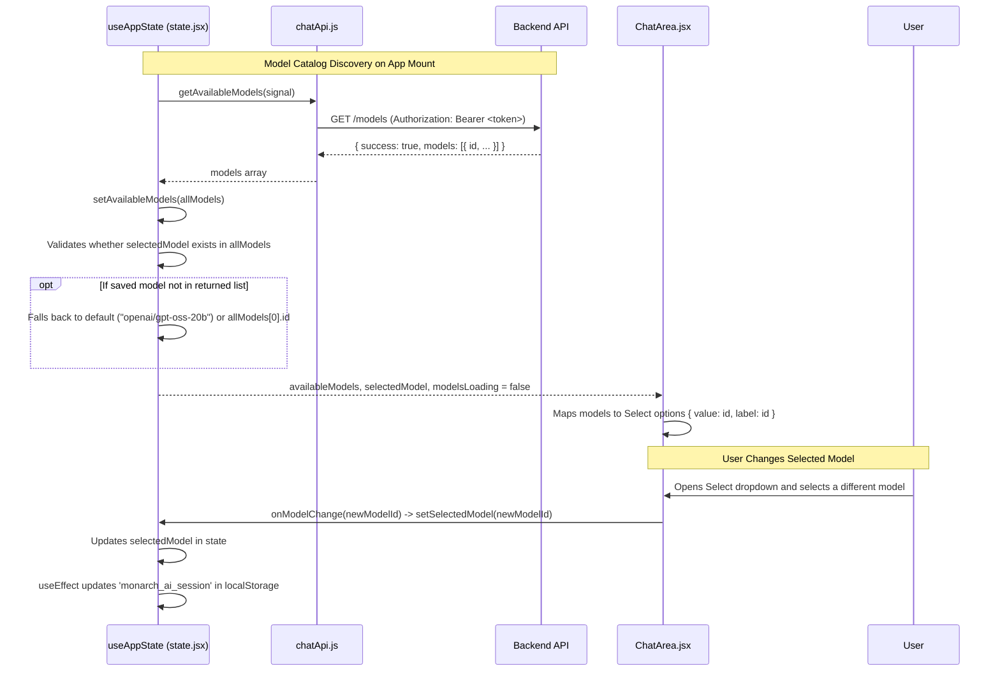
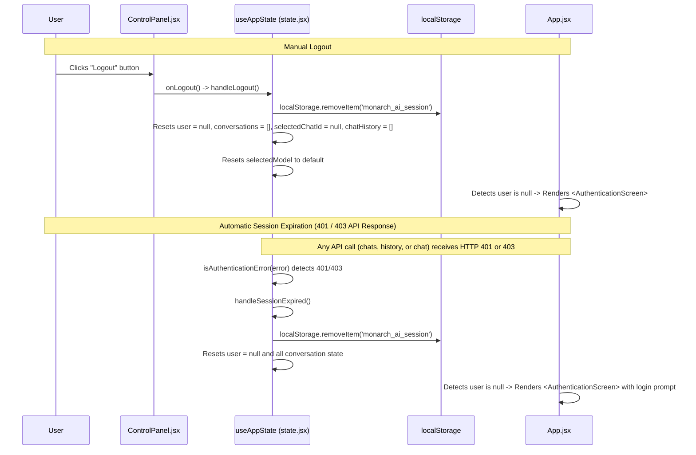

# PROJECT_FLOWS.md — Monarch AI Bot (Client)

---

## A. Application Overview

The Monarch AI Bot client is a single-page React application built with **React 19**, **Vite**, and **Ant Design**. It provides an interface for interacting with Monarch AI backend services.

The frontend communicates with the backend REST API over HTTPS using JSON payloads and Bearer JWT authorization. It supports dynamic model selection, conversational history management, guest user registration and authentication, local session persistence, and Markdown rendering with code syntax highlighting.

### High-Level Frontend Architecture Diagram

---

## B. Application Initialization and Session Restoration Flow

---

## C. Guest Authentication Flows (Signup and Login)

### 1. Guest Registration Flow

### 2. Guest Login Flow

---

## D. Chat Interaction and Message Flow

---

## E. Conversation Navigation and History Retrieval

---

## F. Model Selection Flow

---

## G. Logout and Session Expiration Handling

---

## H. Error Handling and UI States

| Scenario | Originating Service | Catch & Handle Location | UI Presentation | User Recovery Action |
|---|---|---|---|---|
| **Network Timeout (>15s / >30s)** | `auth.js` / `chatApi.js` | `AbortController` timeout timer | Ant Design Alert (`type="error"`) or chat composer error banner | User can retry request |
| **Duplicate In-flight Request** | `auth.js` | `pendingSignups` / `pendingLogins` Map | Throws Error: `"Request is already in progress"` | Request throttling prevents redundant submissions |
| **Expired 24-Hour Account** | Backend API (401 response) | `useAppState.handleSessionExpired()` | Clears session, resets UI to `<AuthenticationScreen>` | User creates new guest account or logs into active account |
| **Invalid Credentials on Login** | Backend API (401 response) | `Account.jsx` `handleSubmit()` | Ant Design Alert (`type="error"`): `"Invalid username or UUID."` | User re-enters credentials |
| **Model Fetch Failure** | `getAvailableModels()` | `useAppState` models effect | Error text beneath model selector; selector disabled | User can refresh or rely on default model |
| **Message Send Failure** | `sendChatMessage()` | `ChatArea.jsx` `handleSendMessage()` | Error banner in ChatArea; message text preserved in composer | User reviews error and clicks Send again |

---

## I. Verification Notes

- All flows traced directly from verified source files in `client/src/`.
- Interactive particle canvas matches `AuthenticationScreen.jsx` Canvas 2D implementation with custom pointer event dispatch.
- Dynamic markdown formatting uses `react-markdown` with `remark-gfm` and `rehype-highlight` configured for GitHub Dark syntax styles.
- Session persistence uses standard HTML5 `localStorage` under the key `monarch_ai_session`.

