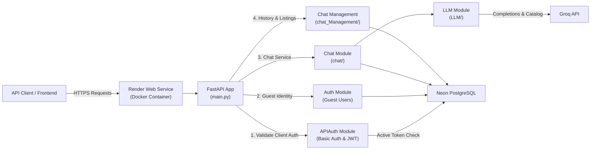
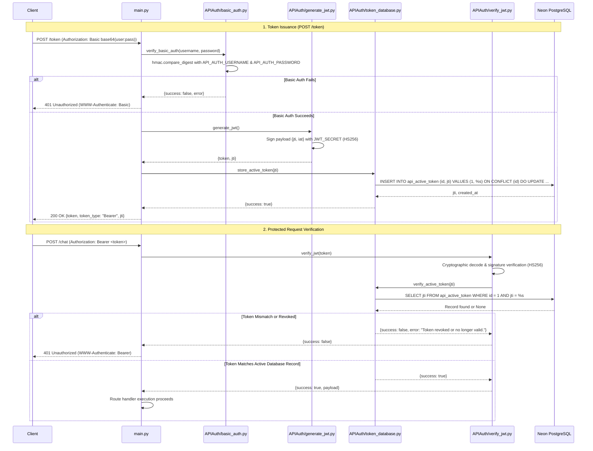
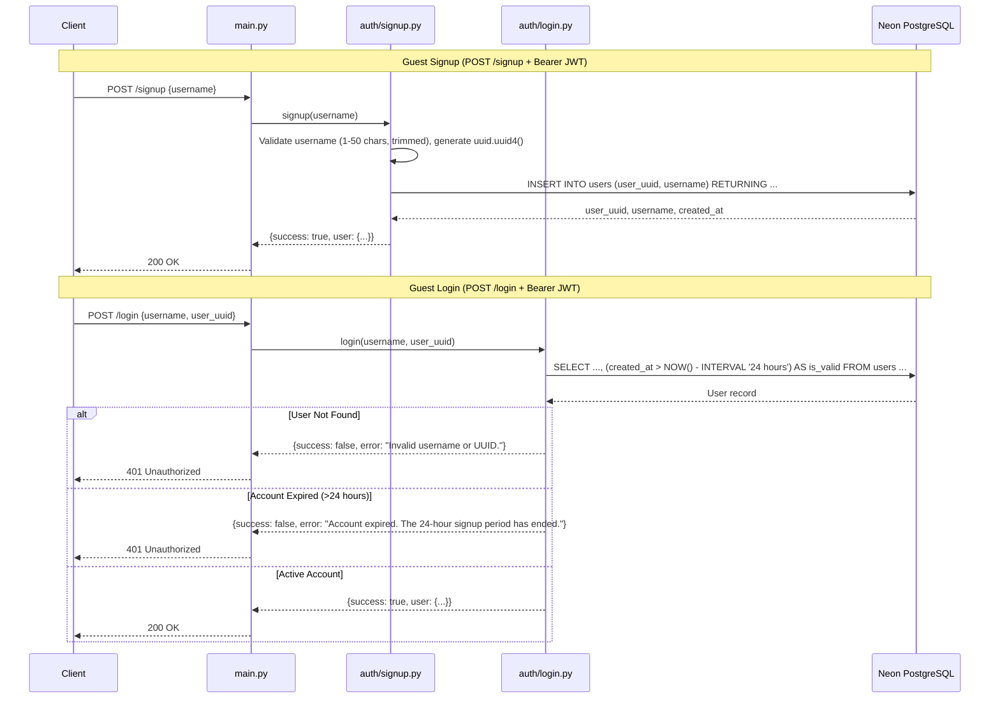
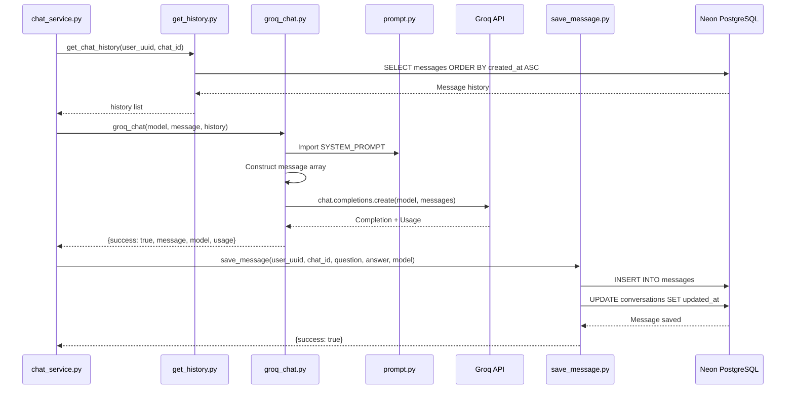

# PROJECT_FLOWS.md — Monarch AI Bot (Server)

---

## A. Application Overview

Monarch AI Bot is a containerized backend REST API deployed on **Render** that allows authenticated clients to converse with LLM models hosted on **Groq**. Relational data (users, active tokens, conversations, messages) is persisted in **Neon PostgreSQL**.

### High-Level Architecture Diagram



### Component Interaction & Deployment Model

1. **Deployment Platform (Render):** The application runs as a containerized web service built from `server/Dockerfile` using `python:3.14-slim` and `uv`. Render provides HTTPS termination, container management, and environment variable injection.
2. **Health Monitoring:** Render or monitoring agents probe `GET /health` to verify server availability.
3. **Dual-Layer Authentication:**
   - **Tier 1 (API Client Level):** API clients authenticate with HTTP Basic Auth at `POST /token` to obtain a signed JWT. Protected endpoints require `Authorization: Bearer <token>`, verified both cryptographically (HS256) and against `api_active_token` in PostgreSQL.
   - **Tier 2 (End-User Level):** Guest users register with a username, obtain a server-generated UUID, and are authorized to interact with the chatbot within a 24-hour window from account creation.
4. **Data Persistence:** Database queries use `psycopg 3` via connection pooling in `auth/database.py`.
5. **LLM Inference:** `LLM/groq_chat.py` interacts with Groq cloud completions with custom system instructions and multi-turn context.

---

## B. Authentication Flow

The application implements a two-tier authentication architecture:

1. **API Client Authentication (Basic Auth + JWT with Database Revocation):** Guards the API endpoints from unauthorized callers.
2. **End-User Guest Authentication (Username + UUID + 24-Hour Expiration):** Identifies end-users and scopes conversations.

---

### Tier 1: API Client Authentication Flow (Token Generation & Verification)



**Single Active Token Mechanism:**
- Storing `id = 1` in `api_active_token` guarantees that generating a new token automatically invalidates any previously issued token.

---

### Tier 2: End-User Guest Authentication Flow (Signup, Login & Expiration)



---

## C. Main Application Flows

### 1. Health Check

- **Trigger:** Health probes from Render, uptime monitors, or external clients.
- **Endpoint:** `GET /health`.
- **Authentication:** None (public endpoint).
- **Handler:** `health_check()` in `main.py`.
- **Response:** `{"success": true, "status": "healthy", "message": "Monarch AI Bot server is running."}`.

### 2. Token Issuance (Client Authentication)

- **Trigger:** API client authenticates using HTTP Basic Auth.
- **Endpoint:** `POST /token`.
- **Authentication:** `require_basic_auth` dependency (`API_AUTH_USERNAME`, `API_AUTH_PASSWORD`).
- **Handler:** `create_access_token()` in `main.py`.
- **Services:** `generate_jwt()` (`APIAuth/generate_jwt.py`), `store_active_token()` (`APIAuth/token_database.py`).
- **Database:** Upsert row with `id = 1` in `api_active_token`.
- **Response:** `{"success": true, "message": "JWT generated successfully.", "token": "...", "token_type": "Bearer", "jti": "..."}`.

### 3. Guest Signup

- **Trigger:** Client sends `POST /signup` with `{"username": "..."}`.
- **Endpoint:** `POST /signup`.
- **Authentication:** Requires active Bearer JWT.
- **Handler:** `user_signup()` in `main.py`.
- **Service:** `signup()` in `auth/signup.py`.
- **Database:** `INSERT INTO users (user_uuid, username) RETURNING ...`.
- **Response:** `{"success": true, "message": "Signup successful.", "user": {"user_uuid": "...", "username": "...", "created_at": "..."}}`.

### 4. User Login

- **Trigger:** Client sends `POST /login` with `{"username": "...", "user_uuid": "..."}`.
- **Endpoint:** `POST /login`.
- **Authentication:** Requires active Bearer JWT.
- **Handler:** `user_login()` in `main.py`.
- **Service:** `login()` in `auth/login.py`.
- **Database:** `SELECT ... FROM users WHERE username = %s AND user_uuid = %s` with 24-hour check.
- **Response:** `{"success": true, "message": "Login successful.", "user": {...}}`.

### 5. Chat Interaction (Send Message & LLM Response)

- **Trigger:** Client sends `POST /chat` with `{"user_uuid", "model", "message", "chat_id?"}`.
- **Endpoint:** `POST /chat`.
- **Authentication:** Requires active Bearer JWT.
- **Handler:** `user_chat()` in `main.py`.
- **Service:** `chat_service()` in `chat/chat_service.py`.
- **Execution steps:**
  1. Validate input fields and user UUID format.
  2. Verify user existence and 24-hour validity in `users`.
  3. If `chat_id` provided, verify ownership in `conversations`.
  4. If `chat_id` omitted, call `create_chat(user_uuid)` to insert a new conversation.
  5. Fetch conversation history via `get_chat_history(user_uuid, chat_id)`.
  6. Invoke `groq_chat(model, message, history)` to get completions from Groq.
  7. Persist question and answer via `save_message(user_uuid, chat_id, question, answer, model)`.
  8. Return completion response with model and token usage.

### 6. Conversation History Retrieval

- **Trigger:** Client sends `POST /chat/history` with `{"user_uuid", "chat_id"}`.
- **Endpoint:** `POST /chat/history`.
- **Authentication:** Requires active Bearer JWT.
- **Handler:** `user_chat_history()` in `main.py`.
- **Service:** `chat_history()` in `chat_Management/chat_history.py` → `get_chat_history()` in `chat/get_history.py`.
- **Database:** `SELECT question, answer, model, created_at FROM messages WHERE user_uuid = %s AND chat_id = %s ORDER BY created_at ASC`.
- **Response:** `{"success": true, "chat_id": "...", "user_uuid": "...", "total_messages": N, "history": [...]}`.

### 7. List User Conversations

- **Trigger:** Client sends `POST /chats` with `{"user_uuid"}`.
- **Endpoint:** `POST /chats`.
- **Authentication:** Requires active Bearer JWT.
- **Handler:** `user_all_chats()` in `main.py`.
- **Service:** `get_all_chats()` in `chat_Management/get_all_chats.py`.
- **Database:** `SELECT chat_id, title, created_at, updated_at FROM conversations WHERE user_uuid = %s ORDER BY updated_at DESC`.
- **Response:** `{"success": true, "user_uuid": "...", "total_conversations": N, "conversations": [...]}`.

### 8. Available Models Discovery

- **Trigger:** Client sends `GET /models`.
- **Endpoint:** `GET /models`.
- **Authentication:** Requires active Bearer JWT.
- **Handler:** `available_models()` in `main.py`.
- **Service:** `get_available_models()` in `LLM/groq_connection.py`.
- **External API:** `Groq().models.list()`.
- **Response:** `{"success": true, "total_models": N, "models": [...]}`.

---

## D. Code Execution Flows

### 1. Inbound Request Protection via JWT Dependency

```text
Inbound HTTP Request to Protected Endpoint
  │
  ▼
FastAPI Dependency: require_jwt() in main.py
  │
  ├── 1. Extract Bearer token from Authorization header
  │
  ├── 2. APIAuth/verify_jwt.py :: verify_jwt(token)
  │      ├── Cryptographic decode with JWT_SECRET (HS256)
  │      ├── Verify presence of claims: 'jti', 'iat'
  │      │
  │      └── 3. APIAuth/token_database.py :: verify_active_token(jti)
  │             └── SQL: SELECT jti FROM api_active_token WHERE id = 1 AND jti = %s
  │
  ├── [If token missing, invalid, or revoked]
  │      └── Raise HTTPException(401, detail=error, headers={"WWW-Authenticate": "Bearer"})
  │
  └── [If token valid & active]
         └── Yield payload to route handler; execution proceeds
```

### 2. Token Creation Flow

```text
Client
  │  POST /token (Authorization: Basic base64(username:password))
  ▼
main.py :: require_basic_auth()
  │  APIAuth/basic_auth.py :: verify_basic_auth(username, password)
  │  hmac.compare_digest with API_AUTH_USERNAME & API_AUTH_PASSWORD
  ▼
main.py :: create_access_token()
  │
  ├── APIAuth/generate_jwt.py :: generate_jwt()
  │   └── Signs {jti: uuid4(), iat: now()} with HS256
  │
  ├── APIAuth/token_database.py :: store_active_token(jti)
  │   └── SQL: INSERT INTO api_active_token (id, jti) VALUES (1, %s)
  │            ON CONFLICT (id) DO UPDATE SET jti = EXCLUDED.jti, created_at = NOW()
  │
  └── Return {success: true, token, token_type: "Bearer", jti}
```

### 3. Chat Message Execution Flow

```text
Client
  │  POST /chat (Authorization: Bearer <token>) {user_uuid, model, message, chat_id?}
  ▼
main.py :: require_jwt() [Validates Bearer token & active DB state]
  ▼
main.py :: user_chat(request: ChatRequest)
  ▼
chat/chat_service.py :: chat_service(user_uuid, model, message, chat_id)
  │
  ├── 1. Validate inputs (ValueError on empty / malformed UUIDs)
  ├── 2. Database check: user eligibility in 'users' (created_at > NOW() - 24 hours)
  ├── 3. [If chat_id given] Database check: conversation ownership in 'conversations'
  ├── 4. [If chat_id None] chat/create_chat.py :: create_chat(user_uuid)
  │      └── SQL: INSERT INTO conversations (user_uuid) RETURNING chat_id, ...
  ├── 5. chat/get_history.py :: get_chat_history(user_uuid, chat_id)
  │      └── SQL: SELECT question, answer, model, created_at FROM messages ORDER BY created_at ASC
  ├── 6. LLM/groq_chat.py :: groq_chat(model, message, history)
  │      ├── Prepend SYSTEM_PROMPT from LLM/prompt.py
  │      ├── Append history pairs and new user message
  │      └── client.chat.completions.create(model, messages) via Groq API
  ├── 7. chat/save_message.py :: save_message(user_uuid, chat_id, question, answer, model)
  │      ├── SQL: INSERT INTO messages (user_uuid, chat_id, question, answer, model)
  │      └── SQL: UPDATE conversations SET updated_at = NOW()
  └── 8. Return {success: true, user_uuid, chat_id, question, answer, model, usage}
  ▼
main.py :: Returns 200 OK JSON response
```

---

## E. API Request and Response Flows

### GET `/health`
- **Auth:** None.
- **Response:** `{"success": true, "status": "healthy", "message": "Monarch AI Bot server is running."}` (HTTP 200).

### POST `/token`
- **Auth:** HTTP Basic Auth (`Authorization: Basic ...`).
- **Body:** Empty.
- **Success Response (200):**
  ```json
  {
      "success": true,
      "message": "JWT generated successfully.",
      "token": "eyJhbGciOi...",
      "token_type": "Bearer",
      "jti": "18f92931-6b83-4a12-88ec-212bb4df59d8"
  }
  ```
- **Error Responses:** 401 Unauthorized (invalid basic auth), 500 (JWT generation or DB storage error).

### GET `/models`
- **Auth:** Bearer JWT.
- **Success Response (200):**
  ```json
  {
      "success": true,
      "total_models": 12,
      "models": [
          {
              "id": "llama-3.3-70b-versatile",
              "owned_by": "Meta",
              "created": "06 December 2024",
              "active": true,
              "context_window": 131072,
              "max_completion_tokens": 32768
          }
      ]
  }
  ```
- **Error Responses:** 401 Unauthorized (JWT error), 500 (Groq API error).

### POST `/signup`
- **Auth:** Bearer JWT.
- **Body:** `{"username": "monarch_user"}`.
- **Success Response (200):**
  ```json
  {
      "success": true,
      "message": "Signup successful.",
      "user": {
          "user_uuid": "13a6aaf9-a69a-4b4c-915b-cd80093552dd",
          "username": "monarch_user",
          "created_at": "2026-11-09T10:00:00.000000"
      }
  }
  ```
- **Error Responses:** 401 Unauthorized, 400 Bad Request (duplicate username, length > 50).

### POST `/login`
- **Auth:** Bearer JWT.
- **Body:** `{"username": "monarch_user", "user_uuid": "13a6aaf9-a69a-4b4c-915b-cd80093552dd"}`.
- **Success Response (200):** Same user payload as signup.
- **Error Responses:** 401 Unauthorized (invalid credentials, expired account past 24 hours, invalid JWT).

### POST `/chat`
- **Auth:** Bearer JWT.
- **Body:** `{"user_uuid": "...", "model": "llama-3.3-70b-versatile", "message": "Hello!", "chat_id": null}`.
- **Success Response (200):**
  ```json
  {
      "success": true,
      "user_uuid": "...",
      "chat_id": "...",
      "question": "Hello!",
      "answer": "Hello! How can I assist you today?",
      "model": "llama-3.3-70b-versatile",
      "usage": {
          "prompt_tokens": 150,
          "completion_tokens": 12,
          "total_tokens": 162
      }
  }
  ```
- **Error Responses:** 401 Unauthorized, 400 Bad Request (expired user, invalid conversation, Groq error).

### POST `/chat/history`
- **Auth:** Bearer JWT.
- **Body:** `{"user_uuid": "...", "chat_id": "..."}`.
- **Success Response (200):**
  ```json
  {
      "success": true,
      "chat_id": "...",
      "user_uuid": "...",
      "total_messages": 2,
      "history": [
          {
              "question": "What is Python?",
              "answer": "Python is a high-level programming language.",
              "model": "llama-3.3-70b-versatile",
              "created_at": "2026-11-09T10:05:00.000000"
          }
      ]
  }
  ```

### POST `/chats`
- **Auth:** Bearer JWT.
- **Body:** `{"user_uuid": "..."}`.
- **Success Response (200):**
  ```json
  {
      "success": true,
      "user_uuid": "...",
      "total_conversations": 1,
      "conversations": [
          {
              "chat_id": "...",
              "title": null,
              "created_at": "...",
              "updated_at": "..."
          }
      ]
  }
  ```

---

## F. LLM Integration Flow

1. **Origin:** Inbound request to `POST /chat` with `user_uuid`, `model`, `message`, and optional `chat_id`.
2. **Context Assembly:** `chat_service()` retrieves prior conversation records from `messages` via `get_chat_history()`.
3. **Prompt Framing:** `groq_chat()` loads `SYSTEM_PROMPT` from `LLM/prompt.py` and builds a structured message list:
   - System prompt (instructions for conciseness, tone, and token efficiency).
   - Past conversation alternating pairs: `{"role": "user", "content": question}`, `{"role": "assistant", "content": answer}`.
   - Latest prompt: `{"role": "user", "content": message}`.
4. **Execution:** Groq client calls `chat.completions.create(model=model, messages=messages)`.
5. **Persistence:** `save_message()` writes the user prompt and LLM answer into `messages`, updating `conversations.updated_at`.
6. **Delivery:** The structured JSON payload is returned to the client.



---

## G. Data Flow

```mermaid
flowchart TD
    Client["API Client / Frontend"]
    FastAPI["FastAPI (main.py)"]
    APIAuth["APIAuth (Basic Auth & JWT)"]
    Auth["auth/ (User Registry)"]
    Chat["chat/ (Chat Service)"]
    ChatMgmt["chat_Management/ (History & Threads)"]
    LLM["LLM/ (Groq Integration)"]
    Postgres["Neon PostgreSQL"]
    Groq["Groq API"]

    Client -->|1. Basic Auth Creds| FastAPI
    FastAPI -->|Validate & Generate| APIAuth
    APIAuth -->|Upsert jti| Postgres
    APIAuth -->|Return Bearer Token| Client

    Client -->|2. Request + Bearer Token| FastAPI
    FastAPI -->|Verify Signature & Active jti| APIAuth
    APIAuth -->|Check jti (id=1)| Postgres

    FastAPI -->|Signup / Login| Auth
    Auth -->|Read/Write User (24h rule)| Postgres

    FastAPI -->|Chat Exchange| Chat
    Chat -->|Fetch History & Save Message| Postgres
    Chat -->|Inference Call| LLM
    LLM -->|Completions| Groq

    FastAPI -->|Thread Queries| ChatMgmt
    ChatMgmt -->|Read Threads & Messages| Postgres

    FastAPI -->|JSON Response| Client
```

### Data Lifecycle

| Data Entity | Origin | Storage Location | Retention / Expiration |
|---|---|---|---|
| **Basic Auth Credentials** | Environment variables (`API_AUTH_USERNAME`, `API_AUTH_PASSWORD`) | Memory / Env | Persistent across runtime |
| **Active JWT ID (`jti`)** | `APIAuth/generate_jwt.py` | `api_active_token` table (`id = 1`) | Single active token; replaced upon next `/token` call |
| **Guest User Account** | `POST /signup` | `users` table | Persists in DB; active for 24 hours from `created_at` |
| **Conversation Thread** | `chat/create_chat.py` | `conversations` table | Persistent |
| **Message Exchange** | `chat/save_message.py` | `messages` table | Persistent |
| **Groq Model Metadata** | Groq API (`models.list()`) | Transient (per request) | Dynamic |

---

## H. Error Handling Flow

### Layered Error Architecture

```text
HTTP Request
     │
     ▼
[Security Dependencies]
  ├── Invalid Basic Auth Credentials   ──► 401 Unauthorized ("WWW-Authenticate: Basic")
  ├── Missing / Invalid JWT Signature  ──► 401 Unauthorized ("WWW-Authenticate: Bearer")
  └── Revoked / Superseded Token (jti) ──► 401 Unauthorized ("Token revoked or no longer valid.")
     │
     ▼
[Pydantic Request Validation]
  └── Malformed JSON / Missing Field   ──► 422 Unprocessable Entity
     │
     ▼
[Business Logic & Service Functions]
  ├── Input Validation (ValueError)    ──► 400 Bad Request
  ├── Duplicate Username (Unique)      ──► 400 Bad Request ("Username already exists.")
  ├── Expired Guest Account (>24h)     ──► 401 Unauthorized (Login) / 400 Bad Request (Chat)
  ├── Conversation Not Owned           ──► 400 Bad Request ("Conversation not found or does not belong to this user.")
  ├── Groq API Failure / Rate Limit    ──► 400 Bad Request (Chat) / 500 Internal Error (Models)
  └── Database Connection Error        ──► 500 Internal Error (Token) / 400 Bad Request
```

---

## I. Background and Scheduled Processes

**No background workers, async jobs, or scheduled tasks are currently implemented.**

- Account expiration (24 hours) is evaluated dynamically at query time using SQL (`created_at > NOW() - INTERVAL '24 hours'`).
- Active JWT revocation is handled on write via the singleton row in `api_active_token`.
- There are no scheduled database cleanup cron jobs, celery workers, or background queues.

---

## J. Flow Accuracy Rules — Verification Notes

- All documented flows correspond directly to verified code in the `server/` directory.
- Docker execution corresponds to `server/Dockerfile` using Python 3.14-slim, uv, and Uvicorn.
- Render web service deployment serves the application at port 8000 with `/health` endpoint checks.
- Dual-tier authentication logic matches `APIAuth/basic_auth.py`, `APIAuth/generate_jwt.py`, `APIAuth/token_database.py`, and `APIAuth/verify_jwt.py`.

